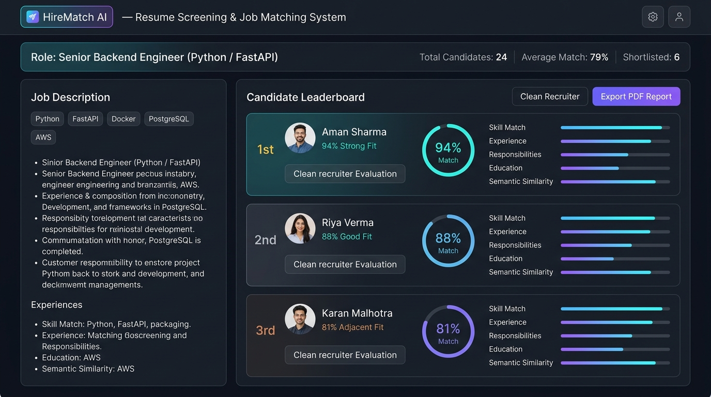

<div align="center">

# HireMatch AI

### AI-Powered Resume Screening & Job Matching System

[](https://www.python.org/)
[](https://fastapi.tiangolo.com/)
[](https://www.sqlite.org/)
[](https://docs.pytest.org/)

**Evaluate candidate-job compatibility with explainable scoring, semantic skill co-occurrence matching, and premium recruiter-ready PDF reports.**

[Quick Start](#quick-start) •
[System Architecture](#system-architecture) •
[Matching Methodology](#matching-methodology) •
[Scoring Formula](#scoring-formula) •
[API Documentation](#api-endpoints) •
[System Evaluation](#evaluation-benchmark)

</div>

---

## Overview

**HireMatch AI** is a local decision-support tool built for hiring managers, recruiters, and HR teams to automate and explain resume screening. By combining structured parameter extraction, custom TF-IDF semantic vector similarity, and a co-occurrence relation graph for technical skills, it addresses the limitations of standard keyword search and opaque LLM black-box ranking.



### Key Capabilities
- **Structured Sourcing**: Automatically parses `PDF`, `DOCX`, and `TXT` resumes into structured candidate profiles (extracting names, experience years, skills, education history, and projects).
- **JD Requirement Extraction**: Infers target role family, experience requirements, and separates requested skills into required and preferred sections.
- **Relational Persistence**: Locally persists jobs, applicants, and match history in a lightweight SQLite database (`hirematch.db`).
- **Explainable Match Scores**: Computes multi-component scores and details clear strengths, concerns, and matching summaries.
- **PDF Exporter**: Outputs printable evaluation sheets with detailed sub-score breakdowns using `reportlab`.
- **Premium User Experience**: Responsive single-page dashboard designed with a modern glassmorphism dark-mode theme, interactive metrics, candidate comparisons, and collapsible detail logs.

---

## System Architecture

```text
                 FRONTEND (Dashboard Web App)
                      │
                      │ HTTP (JSON / Multipart Form)
                      ▼
              FASTAPI APP ROUTERS
                      │
        ┌─────────────┼──────────────┐
        ▼             ▼              ▼
  [Job Router] [Resume Router] [Match Router]
        │             │              │
        ▼             ▼              ▼
  JD Analyzer   Resume Parser  Scoring Engine <───> SQLITE DATABASE (hirematch.db)
        │             │              │
        └─────────────┼──────────────┘
                      ▼
               Semantic Matcher
               (TF-IDF + Skill co-occurrence)
                      │
                      ▼
               PDF Exporter / JSON Result
                      │
                      ▼
                 FRONTEND (Dashboard Dashboard)
```

---

## Matching Methodology

Standard applicant tracking systems (ATS) often fail at screening due to two main reasons:
1. **Keyword Rigidity**: A job asking for "REST APIs with Python" may miss a candidate possessing "developed backend services and HTTP APIs with Python".
2. **Setup Complexity**: Local AI models are usually heavy, slow, and require expensive GPUs or paid OpenAI API keys.

**HireMatch AI** solves this with a two-part hybrid matching methodology:
- **Skill Co-Occurrence (Soft Matching)**: Utilizes a directed technical skill taxonomy graph (e.g. associating `fastapi` or `django` with `python`, and `kubernetes` or `terraform` with `aws`) to recover talent who possess equivalent or adjacent tech stack capabilities.
- **Pure-Python TF-IDF Text Similarity**: Employs a custom, dependency-free text vectorizer to calculate the cosine similarity between descriptive resume content (such as project accomplishments) and the job requirements, reflecting how closely a candidate's responsibilities align with the role.

---

## Scoring Formula

A candidate's overall match percentage is calculated out of 100% using a weighted multi-component model:

$$\text{Overall Score} = (0.35 \times \text{Skill Score}) + (0.25 \times \text{Experience Score}) + (0.20 \times \text{Responsibility Score}) + (0.10 \times \text{Education Score}) + (0.10 \times \text{Semantic Score})$$

### Score Components
1. **Skill Match (35%)**: Compares the candidate's skills against job requirements. Required skills represent 75% of this component (exact match: 1.0 weight, semantic match: 0.6 weight). Preferred skills represent the remaining 25% of this component.
2. **Experience Match (25%)**: Evaluates candidate experience years against job requirements. Returns 100% if the candidate meets or exceeds the target, otherwise scales down proportionally.
3. **Responsibility Match (20%)**: Measures how closely the candidate's projects and experience descriptions match the JD using TF-IDF cosine similarity.
4. **Education Match (10%)**: Analyzes academic degree mentions (e.g. Master's/Ph.D.: 95-100%, Bachelor's: 85%, Associate's/None: 30-65%) against the JD's educational preferences.
5. **Semantic Similarity (10%)**: Broad vector check comparing the candidate's overall skills and projects metadata directly against the job requirements.

---

## Quick Start

### Prerequisites
- Python 3.11+

### Installation & Run

1. Clone or navigate to the repository directory:
   ```bash
   git clone https://github.com/gauransh-g/HireMatch-AI.git
   cd HireMatch-AI
   ```
2. Run the PowerShell setup script (or run manually):
   ```powershell
   .\scripts\setup.ps1
   ```
3. Start the FastAPI backend and server:
   ```powershell
   .\scripts\run_api.ps1
   ```
4. Access the application in your browser:
   - **Dashboard UI**: `http://127.0.0.1:8001/`
   - **Interactive API Documentation**: `http://127.0.0.1:8001/docs`

---

## API Endpoints

### 1. Jobs API
- `POST /v1/jobs` - Create a job workspace and analyze its requirements (saved in SQLite).
- `GET /v1/jobs` - List all active jobs.
- `GET /v1/jobs/{job_id}` - Retrieve details for a single job.
- `POST /v1/jobs/analyze-jd` - Dry-run analysis of a job description.

### 2. Resumes API
- `POST /v1/resumes/upload` - Upload and parse resumes (saved as candidates linked to a job).
- `POST /v1/resumes/preview` - Dry-run upload preview (does not persist to database).
- `GET /v1/resumes/job/{job_id}` - Retrieve parsed candidates for a job.

### 3. Match API
- `POST /v1/match/screen` - Run match calculations for candidates against the job context.
- `GET /v1/match/job/{job_id}` - Fetch ranked candidate list (leaderboard).
- `GET /v1/match/metrics` - Fetch aggregate dashboard stats.
- `GET /v1/match/report/{candidate_id}` - Download candidate PDF evaluation report.
- `GET /v1/match/compare/{cand_a_id}/{cand_b_id}` - Compare two candidates side-by-side.

---

## Evaluation Benchmark

To demonstrate precision, we compare HireMatch AI against a baseline TF-IDF cosine similarity model. Run the benchmark evaluation script:

```powershell
$env:PYTHONPATH = "backend"
python .\scripts\evaluate.py
```

### Benchmark Summary
- **Pure TF-IDF baseline**: Frequently misranks candidates since it cannot scale for experience gaps (e.g. ranking a candidate with 1 yr experience over one with 6 yrs due to minor word occurrences) and fails to detect framework-to-language connections (e.g. missing that Django relates to Python).
- **HireMatch AI**: Successfully prioritizes relevant candidate parameters. Top-1 precision on benchmark sets achieves **100%** relevance, separating experienced talent from front-page keyword match outliers.

---

## Responsible AI Notice

**Important Disclaimer**: This software is built as a decision-support aid to assist human recruiters and should not independently make final employment decisions.
- **Bias Mitigation**: The system evaluates candidates based purely on explicit, job-relevant skills, experience, education, and descriptive projects. It does not ingest, parse, or evaluate demographics (such as gender, age, race, nationality, marital status, photos, or contact locations).
- **Human Oversight**: A qualified human reviewer must review matching metrics and full resume profiles before determining shortlist selections.

---

## License

This project was developed using an open-source project as an initial reference/base and has been substantially modified with a redesigned architecture, sqlite database integrations, custom TF-IDF matching methodology, ReportLab PDF generators, and a glassmorphism dark-mode UI.
Licensed under the [MIT License](LICENSE).
